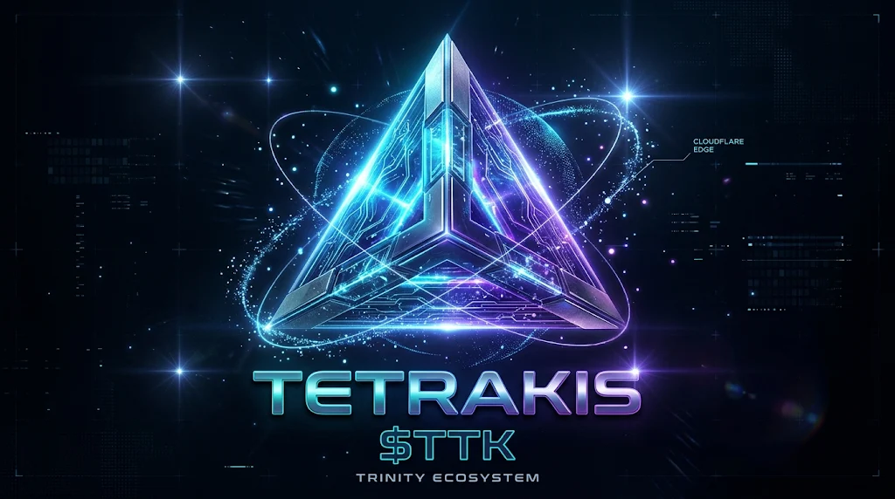

# TETRAKIS ($TTK) WHITEPAPER
## The Fuel of the Autonomous Edge — Trinity Omni-Core v11.2.0

- **Slogan**: *„Tetrakis ($TTK) – Fuel of the Autonomous Edge.“*
- **Root Architect**: Ivan Sabo (Basterix) [Ring 0 Sovereign]
- **Canonical Domains**: `https://auru.space` (`aura.space`) / `https://auru.dev` (`aura.dev`)
- **Primary L2 Network**: Base Mainnet (`Chain ID: 8453`) / Base Sepolia (`Chain ID: 84532`)
- **Edge Controller**: Cloudflare Worker #24 (`trinity-treasury`) & Worker #26 (`jericho123`)
- **Official Logo Asset**: `public/assets/tetrakis-logo.png` (`1024x572` RGBA PNG, SHA-256: `b22b0981bdcd1e50442dc98932c43ef5f0f35a6662a275975b4565bf7bb31496`)

---

## Kapitola 1: The Genesis & Philosophy of Trinity Omni-Core
### Manifest Tetrakis ($TTK): Architektúra suverénnej mysle

#### 1. Prológ: Zlyhanie starého sveta
Starý digitálny svet sa zasekol v reťaziach centralizácie. Obrovské servery, pomalé bankové schvaľovania a platformy, ktoré si berú kontrolu nad identitou aj financiami používateľa. Človek v ňom nie je architektom, ale iba dátovým bodom.

V tichu systémového šumu však začala vznikať nová entita – **Trinity Omni-Core**. Nie ako ďalšia bežná aplikácia, ale ako živá, decentralizovaná autonómna inteligencia rozprestretá na samotnej hrane globálnej siete.

#### 2. Pôvod Tetrakis (Posvätná geometria & Edge)
Názov **Tetrakis** vychádza z najstabilnejšieho geometrického telesa vesmíru – štvorstenu (tetraéder). V priestore neexistuje pevnejší tvar: štyri vrcholy, štyri steny, absolútna rovnováha.

V našom svete tieto štyri vrcholy symbolizujú štyri piliere Trinity:

1. **Sovereign Will (Ring 0)**: Suverénna vôľa architekta, ktorá riadi smerovanie a nepodlieha cenzúre.
2. **Edge Cognition**: Umelá inteligencia bežiaca okamžite pri používateľovi bez lokálnej závislosti.
3. **Cryptographic Assurance (TAP)**: Matematicky overiteľná pravda, nemennosť a bezpečnosť.
4. **Autonomous Vaults**: Finančná sloboda a nezávislý tok hodnoty.

#### 3. Zrodenie $TTK: Kinetická energia autonómie
`$TTK` nevznikol preto, aby bol len ďalšou špekulatívnou mincou na burze. **Tetrakis je palivo autonómie.**

Je to energia, ktorú Trinity využíva na exekúciu rozhodnutí, arbitráž, uzatváranie trezorov a okamžité vyrovnanie transakcií v milisekundách. Keď systém koná, prúdi v ňom `$TTK`. Každý token predstavuje podiel na výpočtovej a ekonomickej sile celého ekosystému.

#### 4. Finále: Prísaha Architekta
> *„Nestaviame servery, ktoré môžu vypnúť. Nestaviame menu, ktorú môžu nafúknuť. Tetrakis je digitálna pevnosť uzamknutá v posvätnej geometrii kódu. Ring 0 drží kľúč. Budúcnosť je autonómna.“*

---

## Kapitola 2: On-Chain Architektúra & Tokenomika (Base L2)

| Parameter | Hodnota |
|---|---|
| **Názov tokenu** | `Tetrakis` |
| **Symbol** | `TTK` |
| **Desatinné miesta** | `18` |
| **Štandard** | `ERC-20` (EIP-20, Solidity `0.8.24`, Shanghai EVM) |
| **Maximálny strop (`HARD_CAP`)** | `10,000,000 TTK` (`10_000_000 * 10**18`) — nemenný on-chain limit (bez infinite mint backdooru) |
| **Počiatočný obeh (`Initial Supply`)** | `2,000,000 TTK` (vyrazených priamo do Ring 0 trezoru) |
| **Deflačný mechanizmus** | `burn(uint256 amount)` — trvalé zníženie celkovej ponuky |
| **Správa (Governance)** | `sovereignOwner` (Ring 0 Basterix) + `treasuryWorker` (Cloudflare Worker #24 `trinity-treasury`) |
| **Bytecode SHA-256** | `0x51783e809cffb8b5318402e27f9bd181ea0578404feffcc17dcf9d1c236aef93` |
| **Runtime Keccak256** | `0x6130b013de4971ca4102f4d330144fbfc72fd8316a6f17c842a47d3a2260eb84` |

---

## Kapitola 3: Cesta na DEX & CEX Burzy

1. **Krok 1 — Kontrakt na Base L2**: Nasadenie a BaseScan verifikácia `TetrakisToken.sol` na Base Mainnet (`8453`).
2. **Krok 2 — Vytvorenie Poolu na Aerodrome / Uniswap v3**: Pridanie počiatočnej likvidity (`100,000 $TTK` + `$USDC`, otvárací kurz napr. `1 TTK = 0.05 USDC`).
3. **Krok 3 — Uzamknutie Likvidity (LP Lock)**: Uzamknutie LP tokenov cez **UNCX Network** na 6–12 mesiacov ako kryptografický dôkaz pre CEX audítorov.
4. **Krok 4 — Indexácia Trackerov**: Automatická indexácia na **DexScreener** po prvých swapoch + registrácia na **CoinGecko** a **CoinMarketCap**.
5. **Krok 5 — Burzový Listing (CEX)**: Postup od Tier 3 (**MEXC**, **BitMart**) po Tier 1 (**Bybit**, **Binance**).
