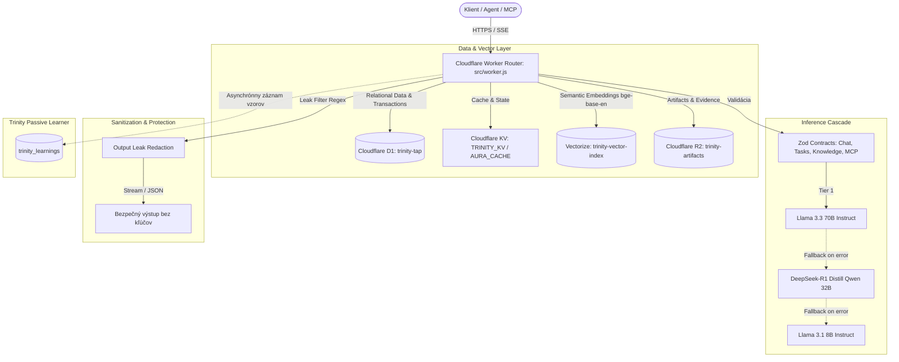

# TRINITY KNOWLEDGE & PATTERN SUMMARY (Ring 0 Continuous Learner)
**Protocol**: AGENT ORCHESTRATION WITH PASSIVE LEARNER CORE  
**Date**: 2026-11-07 04:54 UTC  
**Mode**: STRICT READ-ONLY / ANALYTIC / LEARNING  

---

## 1. Architektonická syntéza vybudovaného systému (3.5.0)

Trinity pasívne zaznamenala a zanalyzovala kompletný produkčný balík vygenerovaný tandemom **Codex GPT** a **Antigravity**:

---

## 2. Zistené anomálie a optimalizácie
1. **Cloudflare Custom Domain Route Syntax**:
   - *Pozorovanie*: Cloudflare Workers pri `custom_domain: true` vyžadujú čistý názov domény (napr. `aura.space`), a nepovoľujú cesty ani zástupné znaky `*` (`aura.space/*`).
   - *Riešenie aplikované Antigravity*: Syntax v `wrangler.jsonc` opravená na striktné `aura.space` a `aura.dev`.
2. **Environment Inheritance v Wrangler**:
   - *Pozorovanie*: Bindingy ako `ai` a `services` sa automaticky nededia do vnútorných sekcií `env.staging`.
   - *Riešenie aplikované Antigravity*: Explicitná deklarácia `ai` a `services` pridaná do `env.staging` aj top-level produkcie.
3. **Multi-Tier Cascade Resilience**:
   - Všetky požiadavky na LLM prechádzajú automatickou kaskádou s logovaním do `trinity_learnings` pri akejkoľvek anomálii.

---

## 3. Zoznam vybudovaných artefaktov
- [wrangler.jsonc](file:///C:/Users/saboi/Trinity/Trinity-antigravity/wrangler.jsonc) — Plná konfigurácia (staging & production) so všetkými 46 prepojeniami a bindingmi.
- [schema.sql](file:///C:/Users/saboi/Trinity/Trinity-antigravity/schema.sql) — D1 schéma (users, sessions, tasks, knowledge_entries, trinity_learnings, audit_logs).
- [src/worker.js](file:///C:/Users/saboi/Trinity/Trinity-antigravity/src/worker.js) — Kompletný unifikovaný kód Workeru (Zod, 3-tier LLM fallback, SSE, Vectorize, D1, MCP).
- [deploy.ps1](file:///C:/Users/saboi/Trinity/Trinity-antigravity/deploy.ps1) — PowerShell skript s auditom, unit testami (60/60 PASS) a dry-run verifikáciou (exit code 0).
- [memory/trinity-blueprint.json](file:///C:/Users/saboi/Trinity/Trinity-antigravity/memory/trinity-blueprint.json) — Formálny JSON Blueprint systému.
